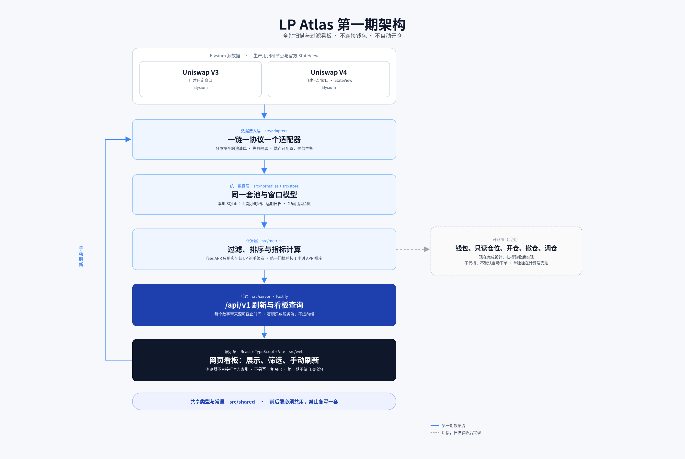

# 四层技术架构

> 2026-11-16已确认RedStone Push统一报价合同见本文末节及方案13第9/9.10节。涉及主资产报价的旧描述已被该合同取代；报价层及历史纠错已部署，本轮统一验收及未恢复限制以05-roadmap“美元计价修复”为准。

第一期实现只做旁路扫描看板，不接热路径开仓。系统拆成四层，每层只做一件事；开仓层单独挂在计算层旁边，不和看板写在同一条链路上。开仓层现在按可签名上链完成设计，实现等扫描验收通过后再写。

| 层 | 做什么 | 第一期怎么落地 |
| --- | --- | --- |
| 数据接入层 | 按链和协议拉取源数据 | 当前启用 Elysium、Robinhood 的 Uniswap V3/V4，场所适配器与共享协议读取器复用。统一五分钟调度、按链互斥、协议游标续接。各链保持实际 RPC 配置，公开源标 public_temporary；统一根报价使用 RedStone Push。精确费用与估算状态分别保留 |
| 统一数据层 | 换成同一种内部格式并存储 | 按链、协议、池统一字段，SQLite/libsql 保存原币小时累计、美元计价版本、协议游标及发布版本，小时结果事务提交。小时档保留4天，不另存五分钟快照；未实施远期日档归并。金额用高精度 |
| 计算层 | 算出看板要的数，再过滤排序 | 六窗口为1H、2H、4H、6H、24H、3D。统一使用1H准入：TVL≥$1,000、成交量≥$100、LP手续费≥$10；默认按1H fees APR降序。不设APR门槛。资金效率为对应窗口成交量/TVL，报价缺失不补零 |
| 展示层 | 只负责显示、筛选和自动载入已发布结果 | 网页看板。刷新时由服务端去拉源数据并计算，浏览器不直接打官方索引，避免跨域和密钥暴露 |
| 开仓层（后接） | 钱包、只读仓位、开仓、撤仓、调仓 | 现在按用户签名上链完成设计，不代持、不默认自动下单。实现等扫描验收通过后再写，单独接在计算层旁，自己管组交易、私有节点和滑点保护 |

目录按这四层切：`src/adapters/`、`src/normalize/`、`src/store/`、`src/metrics/`、`src/web/`、`src/shared/`。HTTP 进程放在 `src/server/`，只作为 API 宿主。

当前已启用 Elysium 与 Robinhood 的 Uniswap V3/V4。BSC、Ethereum、Base、Solana 等目录仍为规划占位，未经授权不得启用；扩展时沿用场所适配器、共享计算和展示，不另建扫描管线。

看板上要标 hook 类型。同一交易对在不同协议里分行展示，不合成一行。

结构预留（目录、多链过滤、刷新范围、前端路由）见 `docs/04-standards/03-code.md` 中「面向全期的结构预留」。`src/server` 负责API和调度，`src/shared` 承载合同；`research/` 是离线研究，不由生产采集调用。当前仍使用同一SQLite库，链隔离依靠查询条件、身份键与互斥，不表示每链独立数据库。

## 多链统一报价架构

2026-11-16用户已确认的报价合同见[方案13第9/9.10节](../05-operations/13-dollar-valuation-repair-review-2026-11-16.md#9-统一报价层落地设计本轮方案正文)，取代此前Alchemy作为主源、Hyperliquid作为主源及10分钟有效期的调查建议；原文相关旧计价描述只说明旧生产状态，不作本次实施规则。2026-11-16用户追加授权停采集更新后恢复，RedStone代码与迁移012已部署，17:08补丁加载至API27116；包装映射、完整保留期及本轮真实验收已核，未恢复记录和精确费用限制保留；唯一进度见05-roadmap“美元计价修复”。

- 在现有四层内实现统一报价能力，不另起服务/扫描管线。主源RedStone Push，两条已启用业务链共用ETH/USD、HYPE/USD；报价按资产＋来源＋目标时间共享，池状态、目录及游标按链隔离。各链采集RPC维持实际配置，本方案不自动迁移到Alchemy；Alchemy Prices API仅可选适配，本期不接Chainlink备源，不假设备源资产覆盖对称。
- 接受Push心跳/偏差的最新有效价，如实记录publishedAt；不要求每轮五分钟新价，不混用早期10分钟有效期与六小时心跳，不靠加频读取刷新预言机。源链历史块必须block.timestamp <= targetAt，报价publishedAt也不晚于targetAt；五分钟桶命中仍核时间，禁止跨链套区块号、未来最近块和当前价回填历史。
- 仅已验证1:1包装的WETH/WHYPE同价；本轮仅核定Elysium官方WHYPE和Robinhood官方WETH（地址及相同运行代码证据见13第9.12节），其他映射未启用；同名币、质押衍生币及任意桥接币不得自动串价。根价先锁定，池推导不得回写，同一计算内原生/包装引用同一值。
- 复用原币累计及repair-hour按小时重建价格表，重估旧版本非空错误金额，不重拉全部Swap、不统一倍乘。TVL仍依赖业务链历史储备；修复不得覆盖较新续接，失败保留旧值及旧计价版本。金额、来源引用/计价版本、链发布版本沿小时事务提交。
- 报价失败不得阻止原币成交、费用和覆盖提交；美元缺失不补0、不把陈旧金额标成当前完成。价格使用独立超时与请求资源，不继承360秒日志等待，有限尝试后快速结束，不与日志或另一资产互相阻塞。关闭新报价不得静默恢复已证实错误的旧多跳为正确值。
- 不改变费用算法、窗口、保留期、准入、前端布局或未启用场所。实施/部署授权与文档合同确认分开记录，不因本节写入就标记代码或金额验收完成。
